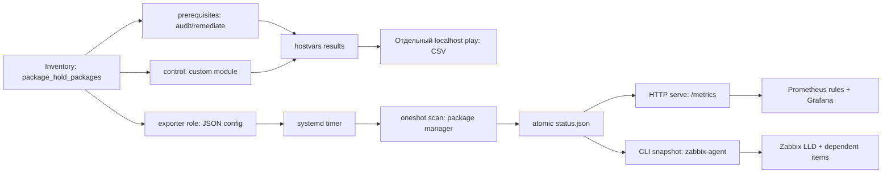

# Архитектура package hold, контракт v1

Статус: контракт реализован в 0.2.0 для тестового развёртывания. Дата: 2026-10-03.
Проверенная конфигурация controller: ansible-core 2.13.13, Python 3.8.20.
Верхнее ограничение версии Ansible не задано; совместимость новых версий не проверялась. Production acceptance требует целевых VM.
Локальные роли и модули подключаются через ansible.cfg из корня проекта.
Нормативные требования этого документа определяют поведение реализации и acceptance.

## Границы и модель

Контролируем только штатный hold установленных пакетов. Нет ожидаемой/одобренной
версии, истории версий, transaction gate, auditd и зависимости от процесса другого подразделения.
NEVRA используется только как технический аргумент DNF при создании lock; наружу версии не выходят.
Наличие hold не гарантирует защиту от явного отключения плагина, прямого rpm или всех
особенностей dependency solver. Ограничения ALT существенны: [compatibility](compatibility.md).

Единый `package_hold_packages` задаётся только inventory. Все три роли валидируют
его по [schema](inventory-schema.md); не имеют своих копий списка и не устанавливают
перечисленное ПО. Сначала определяется применимость mapping, затем установленность,
затем hold. Отсутствующий пакет не порождает записи результата, CSV, metric или LLD.
Неприменимость через null и отсутствие установленного пакета — разные внутренние причины пропуска.
Ошибка запроса установленности не означает отсутствие: это host-level error.

Для установленного пакета результат ровно `held`, `unheld`, `unknown`.
`unknown` сопровождается кодом ошибки; он никогда не преобразуется в `unheld`.
Все установленные архитектуры одного имени образуют одну логическую запись:
все held => held; хотя бы одна unknown => unknown; иначе хотя бы одна unheld => unheld.
Метапакет не означает его зависимости: каждое требуемое бинарное имя задаётся отдельно.

## Поток данных



Module и exporter имеют разные реализации backend. Module может использовать
`module_utils/`; exporter — один Python 3.8 файл, standard library, без
импорта Ansible backend и без PyPI. Общие только документы, schemas и fixtures.
HTTP и Zabbix CLI никогда не вызывают rpm/dnf/apt, включая startup и ошибки cache.

## Локальные роли и модули

`ansible.cfg`, `library/package_hold.py`,
`module_utils/`, `roles/{package_hold_prerequisites,package_hold_control,package_hold_exporter}`,
`playbooks/`, `docs/`, `schemas/`, `tests/`, `monitoring/`.
Runtime реализован в library/module_utils и отдельном `package-hold-exporter.py`.
Роли выполняют проверки и изменения; неиспользуемые stage-файлы не исполняются.

* prerequisites: audit по умолчанию; определяет OS ID/VERSION_ID и capabilities;
  проверяет исполняемые файлы, plugin enabled, читаемость конфигурации и доступность
  штатного backend. В remediate устанавливает только отсутствующие prerequisites,
  затем **повторяет** проверку. Disabled plugin не исправляется молча: отдельная
  ошибка конфигурации. Для Astra/ALT отсутствие базового менеджера — bootstrap error,
  не попытка восстановить ОС через отсутствующий менеджер. Python bootstrap вне роли.
* control: audit => module state=query; remediate => state=held. Unhold доступен
  только через явно вызванный module state=unheld. Нет постоянного audit-скрипта.
  В штатном цикле обслуживания оператор явно unhold/обновляет/held; timer только читает.
* exporter: state=present/absent. Установка JSON, пользователя, трёх systemd units,
  optional Zabbix include. Удаление отключает timer и оба services, удаляет только
  принадлежащие роли файлы, cache и пользователя, делает daemon-reload; hold остаётся.
  Нельзя вызывать `meta: end_play` при state=absent: это остановило бы другие роли.
  `clean` с тегами never/clean — только отдельный play, завершается end_play.

Ролевые переменные имеют префикс роли. Исключение по требованию задачи — общий
`package_hold_packages` (обязателен, default не задан). Все defaults перечислены
в `roles/*/defaults/main.yml`. Журналы идут в journald, logrotate не нужен.
TLS реализуется инфраструктурным reverse proxy при необходимости, ssl stage не нужен.

## Контракты Ansible

Module принимает **уже разрешённый** массив `packages: [{id, name}]`, необязательный `backend`
(enum dnf_versionlock/dpkg_selections/alt_rpm_hold), `state` (query/held/unheld),
`command_timeout_seconds` (30), `lock_timeout_seconds` (10). Список разрешает
controller-side filter `filter_plugins/package_hold.py`; exporter role
использует тот же filter для config. Module повторно валидирует resolved input и
выбирает backend автоматически по ОС. Явно переданный backend проверяется на совместимость.
Роли отвечают за inventory mapping; module не знает inventory.
Query — alias audit на уровне роли; отдельного неоднозначного аргумента audit нет.

Return JSON определён `schemas/module-result.schema.json`, пример:

```json
{"schema_version":1,"changed":false,"failed":false,"check_mode":false,
 "backend":"dpkg_selections","operation":"query",
 "packages":[{"id":"nginx","package":"nginx","state":"held",
 "before_state":"held","changed":false,"would_change":false,"error":null}],
 "errors":[]}
```

Ключи обязательны. `state` — фактически наблюдённый результат после операции;
`before_state` — исходное наблюдение. Query ничего не меняет. В check_mode никакой
записи, lock-file creation или command mutation; `state=before_state`, `would_change`
показывает план, `changed=any(would_change)`. В обычном режиме would_change=false,
changed отражает фактическую запись (включая запись перед неуспешной перепроверкой).
Ошибка не стирает changed. Unknown запрещает mutation этого пакета. Unheld при held
запросе меняется и перепроверяется; повторный вызов changed=false. Частичный результат
сохраняется при fail_json: failed=true, успешно обработанные пакеты не теряются.
Отсутствующие пакеты не входят даже в skipped output. Errors верхнего уровня —
ошибки хоста/конфигурации/определения установленности, без package_id для неподтверждённых пакетов.

Prerequisites result (registered fact `package_hold_prerequisites_result`):
`schema_version:1, os:{id,version_id}, backend:string|null, mode:audit|remediate,
check_mode:bool, changed:bool, success:bool, components:[{name,available_before:bool,
available_after:bool,changed:bool,would_change:bool,error:object|null}], errors:[]`.
Error во всех контрактах: `{code:string,message:string}`; codes перечислены в backend-contract.
В check_mode available_after=available_before: запланированная установка не успешная проверка.
Control fact — полный module result `package_hold_control_result` плюс run_id.

## CSV: один writer после всех hosts

Не использовать append из delegated per-host tasks. Не использовать run_once внутри
serial play для финального файла: run_once исполняется на каждом batch.
Оркестрация состоит из controller-init play (run_id и frozen target host list),
managed-host play (любые serial batches), отдельного `hosts: localhost` finalize play.
Последний собирает только hostvars текущего run_id; записи предыдущего fact cache игнорируются.
Один localhost task `run_once: true`, `delegate_to: localhost`, `become: false`
сериализует весь документ в UTF-8 LF (csv.writer lineterminator='\n'), затем atomic replace.
`strategy: free` не используется для агрегации; localhost play начинается после завершения batches.
`--limit` должен включать localhost; playbook wrapper обязан проверять это до запуска.

Каждый запуск пишет отдельный каталог `reports/<UTC timestamp>-<UUID>/`, mode 0700,
файлы 0600. Два controller запуска не делят output. Имена хостов берутся из inventory,
не из удалённого ввода. csv.writer выполняет quoting; текстовые значения, начинающиеся
с =,+,-,@, TAB, CR, префиксуются апострофом для spreadsheet safety.

* prerequisites.csv: `run_id,host,os_id,os_version,backend,mode,component,available_before,available_after,changed,would_change,check_mode,error_code`.
* hold.csv: `run_id,host,os_id,backend,package_id,package,state,before_state,changed,would_change,check_mode,error_code`.
  Только подтверждённо установленные пакеты; no installed => только header.
* hosts.csv: `run_id,host,phase,success,error_code,message` — unreachable, missing
  results, ошибки определения установленности, configuration errors и coverage итог.

Registered results собираются через block/rescue и controlled failed_when; после
записи CSV finalize явно завершает play ошибкой, если есть host failure/unknown.
Начальный result отмечается failed/missing_result до получения наблюдений.
Managed play использует ignore_unreachable, чтобы даже потеря всех targets не
остановила отдельный localhost finalize; unreachable platform probe преобразуется
ролью в host_unreachable. Это сохраняет ошибочный coverage, а не скрывает сбой.
Unreachable host не получает вымышленные package rows. При полном падении controller
отчёт может не появиться; он никогда не выдаётся за полный.

## Scanner, cache и systemd

Пути: `/usr/local/libexec/package-hold-exporter.py` root:root 0755;
`/etc/package-hold-exporter/config.json` root:root 0644;
`/var/lib/package-hold-exporter/` root:root 0755, status.json root:root 0644.
Config/cache не содержат секретов. HTTP user `package-hold-exporter`, без shell;
Zabbix user имеет read-only доступ. `/run/package-hold-exporter/scan.lock` root-only.
Binary subcommands: `scan --config PATH`, `serve --config PATH`,
`zabbix-snapshot --config PATH`; последний возвращает нормализованный JSON для
LLD и dependent items. Exit codes: 0 успех; 1 scan/check failure; 2 config/CLI error;
3 duplicate scan lock busy. Нечитаемый cache для snapshot — успешный health payload
с cache_valid=0, packages=[], а не пакетный scan.

Units: package-hold-scan.timer, package-hold-scan.service (Type=oneshot, root),
package-hold-exporter.service (непривилегированный HTTP, Restart=on-failure).
Timer OnBootSec=30s, OnUnitActiveSec=I, AccuracySec=1s, RandomizedDelaySec=0.
Default I=300s, total scan deadline D=60s, command timeout C=30s; 0<C<=D<I.
TimeoutStartSec=D+5; subprocess timeout и остаток общего deadline ограничивают команды.
Сканирование списка пакетами выполняется batch queries, иначе время растёт с N.
flock запрещает наложение ручного scan и timer. Блокировка не блокирует updates ОС.
Unit sandbox: NoNewPrivileges, PrivateTmp, ProtectHome; HTTP ProtectSystem=strict,
read-only cache/config. Scanner ReadWritePaths только cache и runtime lock;
read-only backend commands должны работать с отключёнными repo/network refresh.
Профиль hardening требует VM-теста (DNF может обращаться к служебным файлам).
Read-only DNF probes используют disposable scratch для logdir/cachedir/persistdir;
проверка executable package identity идёт через RPM. Непустой RED OS 7.3.6 scanner
проверен в native Docker под этим sandbox. После изменения code/config/units роль
асинхронно запускает scan, чтобы не ждать очередные 300s с invalid digest; HTTP
запускается независимо от результата scanner. VM MAC acceptance остаётся обязательным.

Cache JSON — `schemas/status.schema.json`; timestamps UNIX seconds UTC (0=never),
scan_id новый UUID, config_digest SHA256 canonical resolved config, boot_id из proc.
Reader обязан валидировать schema, digest, finite timestamps и размер <=4 MiB.
Fresh определяется `0 <= now-last_completed <= stale_after`,
`stale_after=2*I+D+2` (default 662s), cache_valid=1 и тот же config_digest/boot_id.
Clock jump назад делает stale; streak сбрасывается при смене boot/config.

Алгоритм записи: flock -> прочитать предыдущий completed snapshot в память ->
atomic **attempt marker** (новый scan_id, attempted_at=now, completed_at=0,
scan_success=false, packages=[], старый last_success_at) -> queries -> atomic final.
Marker предотвращает подачу старого held/unheld как результата упавшего запуска.
Он временно обнуляет package series; короткие health alerts используют for:1m.
Вместо записи in-place: mkstemp в том же каталоге, mode/chown, write, flush,
fsync(file), os.replace, fsync(directory); удалять только свой temp при ошибке.
Reader один раз открывает и читает целый файл; JSON parse failure => health-only.

| Событие | Публикуемый результат |
|---|---|
| Успех | Только текущие installed; success=true; last_success_at=completed_at |
| Ошибка hold одного установленного | Его unknown/error, остальные свежие; success=false; last_success_at прежний |
| Ошибка installed inventory / весь scan | packages=[], success=false; attempted/completed и host error |
| SIGKILL после marker | marker остаётся, packages=[]; scan failure и затем stale |
| Ошибка записи marker | scan прерывается; старый cache неизменен, позже stale; journald фиксирует ошибку |
| Пустой installed set | packages=[], success=true; нормальные timestamps и health |
| Пакет удалён | Удалить запись в ближайшем завершённом scan; сбросить streak |

HTTP продолжает 200 /metrics при scanner errors, отдавая health. Missing/corrupt
cache => cache_valid=0, scan_success=0, timestamps=0, пакетных series нет.
Stale cache => cache_valid=1, health сохраняется, пакетные series не публикуются.
Нельзя обнаружить удаление пакета между scans: данные актуальны на момент наблюдения;
это ограничение любого polling. Старые данные не объявляются новыми.
GET /healthz = 200 для liveness; неизвестный path 404. Content-Type Prometheus text 0.0.4,
HTTP handler ограничивает размер/время чтения; максимум 16 concurrent clients,
избыточные соединения закрываются. Слоты освобождаются после завершения/ошибки;
IPv4 и literal IPv6 bind поддержаны. Сервис предназначен для внутренней сети.

## Устойчивый UNHELD

Один scrape не является scan. Scanner хранит для каждой установленной записи
`unheld_streak`, `unheld_since`, `persistent_unheld`.
На held/unknown сброс в 0/0/false. На unheld начать 1/current_completed, либо
увеличить streak только если предыдущий completed scan того же boot/config имел
этот пакет unheld и gap <= I+D+2. Пропущенный/failed scan или изменившийся identity
сбрасывает серию. Частичная ошибка другого пакета не обнуляет успешные наблюдения.
Повторное чтение cache никогда не увеличивает streak.

persistent=true только когда streak>=3 И completed_at-unheld_since>I.
При I=300 и точном расписании: unheld в 0,300,600 => persistent в 600s;
unheld только в 0, затем held или scanner death => persistent никогда.
Это консервативно требует более одного интервала и адаптируется к I без генерации
динамического Prometheus for. Дополнительное for:1m откладывает firing после
появления evidence. Marker временно удаляет series и может сбросить pending/firing:
это не механизм удержания уже активного alert через scan. После завершения scan
с persistent evidence alert снова может fire через 1m.
Наблюдения не доказывают непрерывность между scans; штатный цикл между ними невидим.
Reader при stale/invalid возвращает persistent=0 (Zabbix) или опускает series (Prometheus).

## Реализация и acceptance

См. [implementation-tasks.md](implementation-tasks.md), [monitoring.md](monitoring.md),
[testing.md](testing.md). Настоящий production release допускается только после VM
acceptance для каждого заявленного профиля. Непроверенные профили не заявляются как сертифицированные. Локальные результаты
зафиксированы в [verification.md](verification.md).
